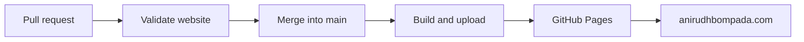

# GitHub Actions and Automation

[← Documentation index](../docs/README.md) · [Hosting and DNS](../docs/deployment.md)

This directory contains the workflows that **validate pull requests** and **publish the static website**. This file is intentionally named `WORKFLOWS.md`, not `.github/README.md`, so the repository root README remains the project landing page on GitHub.

## Workflow overview

| File | Trigger | Outcome |
| --- | --- | --- |
| [`workflows/validate.yml`](workflows/validate.yml) | Pull requests targeting `main`, or manual dispatch | Checks Astro/TypeScript and verifies the production build |
| [`workflows/deploy.yml`](workflows/deploy.yml) | Pushes to `main`, or manual dispatch | Builds the site and publishes to GitHub Pages |
| [`dependabot.yml`](dependabot.yml) | Weekly schedule | Proposes npm and GitHub Actions dependency updates |

## Pull request validation

The **Validate website** workflow:

1. Checks out the proposed code.
2. Sets up Node.js from the repository's `.nvmrc` and enables npm caching.
3. Runs `npm ci`.
4. Runs `npm run check` for Astro/TypeScript diagnostics.
5. Runs `npm run build` to confirm the static site can be generated.

The workflow has **read-only repository token permissions**. Its job is named `build`, which is the required status check in the current `main` ruleset. The ruleset also requires pull requests and prevents force-pushes and deletion.

## GitHub Pages deployment

The **Deploy to GitHub Pages** workflow runs after a push to `main` (normally after merging a PR):

1. The `build` job checks out the repository.
2. The pinned `withastro/action` installs dependencies, runs the Astro build, and uploads the generated static site for Pages.
3. The `deploy` job runs only after the build succeeds and uses `actions/deploy-pages` to publish the artifact.
4. GitHub Pages serves the site through the configured custom domain.

The build job has `contents: read`. The deployment job has `pages: write` and `id-token: write` to publish to the `github-pages` environment. Actions are pinned to commit SHAs.

Deployment runs share a concurrency group named `pages`; a newer run can cancel an in-progress older run.

## How to run workflows manually

Open the repository's **Actions** tab, choose **Validate website** or **Deploy to GitHub Pages**, select **Run workflow**, and run against the intended branch. For routine updates, prefer the normal pull request → merge → automatic deployment path.

Do **not** bypass a failed validation check just to deploy. Inspect the failing job first.

## Dependabot

The weekly [Dependabot configuration](dependabot.yml) checks both npm dependencies and GitHub Actions, with up to three open PRs for each ecosystem. Review changes and let pull request validation finish before merging.

## Troubleshooting

- **Validation failure:** Open the failed job logs, reproduce with `npm ci`, `npm run check`, and `npm run build` locally, then fix the PR.
- **Build or deployment failure:** Read the deployment run logs and check whether the failure occurred in `build` or `deploy`.
- **Build passed, site not updated:** Verify the correct `main` commit was deployed, then check Pages settings, the custom domain, and DNS.
- **Domain/certificate issue:** Follow [Hosting, Domain, and HTTPS](../docs/deployment.md); do not remove DNS verification or email records while diagnosing.

There are no secrets or private credentials to copy into this guide. Never commit GitHub tokens or account credentials.
