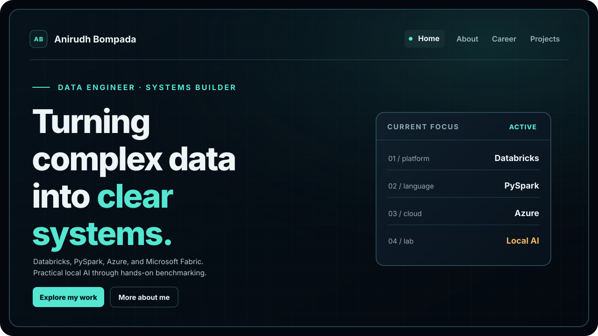

<div align="center">

# Anirudh Bompada — Personal Site

**Data Engineer** · Databricks · PySpark · Azure · Local AI

[Visit the website](https://anirudhbompada.com/) · [Technical documentation](docs/README.md)

[](https://github.com/anirudh-bompada/personal-site/actions/workflows/deploy.yml)



</div>

## Overview

A personal portfolio showcasing data engineering, cloud-platform experience,
technical projects, and practical local AI experiments.

| Site | Built with | Hosted on |
| --- | --- | --- |
| [anirudhbompada.com](https://anirudhbompada.com/) | [Astro](https://astro.build/) · TypeScript · CSS | GitHub Pages |

## Quick start

```bash
npm ci
npm run dev
```

Use `npm run check` to validate Astro and TypeScript, and `npm run build`
to generate the production site.

## Documentation

**[Read the technical guide →](docs/README.md)** for local setup, deployment,
DNS/HTTPS, analytics, SEO, security, and maintenance.

## License

No open-source license has been selected for this repository.
