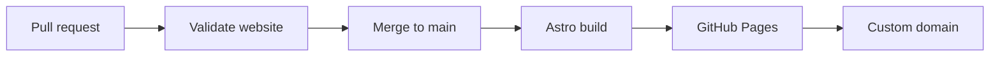

# Personal Site — Technical Guide

> A reference for building, publishing, and maintaining the [personal website](https://anirudhbompada.com/).
> [← Back to the short README](../README.md)

## Find what you need

| Build & develop | Publish & operate | Content & privacy |
| --- | --- | --- |
| [Tech stack](#technology) | [Deployment](#deployment) | [Pages](#what-is-included) |
| [Repository layout](#repository-structure) | [Domain & HTTPS](#custom-domain-and-https) | [Content guidelines](#content-status) |
| [Local setup](#local-development) | [Security & maintenance](#repository-security-and-maintenance) | [SEO](#search-engine-discovery) |
| [Commands](#available-commands) | [Live site](#live-site) | [Analytics](#privacy-conscious-analytics) |

---
## Live site

- **Production domain:** [anirudhbompada.com](https://anirudhbompada.com/)
- **Source repository:** [anirudh-bompada/personal-site](https://github.com/anirudh-bompada/personal-site)

GitHub Pages serves the site over HTTPS, redirects HTTP to HTTPS, and redirects
`www.anirudhbompada.com` to the apex domain.

## What is included

The site contains eight statically generated pages:

| Page | Purpose |
| --- | --- |
| **Home** | Technical focus and one featured, active experiment |
| **About** | Problem-solving approach and documented tradeoffs |
| **Career** | Data-engineering experience without employers or private details |
| **Projects** | Active benchmark and clearly labeled design exploration |
| **LLM Benchmark Lab** | Independent testing methodology under Projects |
| **Blog** | Placeholder for future technical notes; not in main navigation |
| **Contact** | Domain-based email forwarding; no personal inbox address or form |
| **Privacy** | Plain-language disclosure of cookie-free Umami analytics |

The primary navigation links to Home, About, Career, and Projects. The Blog
remains a placeholder outside navigation until there is an article to read.
Contact and Privacy are linked from the site footer.

The interface is responsive,
keyboard accessible, and designed without a client-side JavaScript framework.

## Technology

- [Astro](https://astro.build/) for static-site generation
- TypeScript-aware Astro components
- Plain CSS with responsive layouts and reduced-motion support
- GitHub Actions for automated builds
- GitHub Pages for hosting

## Repository structure

<details>
<summary><strong>Expand repository file tree</strong></summary>

```text
personal-site/
├── docs/
│   ├── README.md            # Detailed technical documentation
│   └── assets/
│       └── homepage-preview.svg # README preview artwork
├── .github/
│   ├── workflows/
│   │   ├── deploy.yml       # Build and GitHub Pages deployment
│   │   └── validate.yml     # Pull request build validation
│   └── dependabot.yml      # Weekly dependency update checks
├── public/
│   └── favicon.svg          # Static public assets
├── src/
│   ├── components/
│   │   ├── Footer.astro     # Shared site footer
│   │   └── Header.astro     # Shared navigation and wordmark
│   ├── layouts/
│   │   └── BaseLayout.astro # HTML shell, metadata, header, and footer
│   ├── pages/
│   │   ├── about.astro
│   │   ├── blog.astro
│   │   ├── career.astro
│   │   ├── contact.astro
│   │   ├── index.astro
│   │   ├── projects.astro
│   │   ├── privacy.astro
│   │   ├── robots.txt.ts     # Build-time crawler instructions
│   │   ├── sitemap.xml.ts   # Curated XML sitemap
│   │   └── projects/
│   │       └── llm-benchmark.astro # Detailed personal benchmark route
│   └── styles/
│       └── global.css       # Design tokens and responsive site styles
├── .gitignore
├── .nvmrc                   # Recommended Node.js major version
├── astro.config.mjs         # Astro and deployment-path configuration
├── package-lock.json        # Reproducible npm dependency versions
├── package.json             # Project metadata and npm commands
└── tsconfig.json            # Astro TypeScript configuration
```

</details>

## Local development

### Prerequisites

- Node.js 24 is recommended; Astro requires Node.js 22.12 or newer
- npm 11 or a compatible npm version

### Setup

```bash
git clone https://github.com/anirudh-bompada/personal-site.git
cd personal-site
npm ci
npm run dev
```

Astro will display the local development URL in the terminal, normally
`http://localhost:4321`.

## Available commands

| Command | Purpose |
| --- | --- |
| `npm ci` | Install the exact dependency versions in `package-lock.json` |
| `npm run dev` | Start the local Astro development server |
| `npm run check` | Check Astro and TypeScript diagnostics |
| `npm run build` | Generate the production site in `dist/` |
| `npm run preview` | Preview the most recent production build locally |

## Deployment

Pull requests must pass the `Validate website` check before merging into `main`.
After a merge, GitHub Actions builds and publishes the static site:



Every push to `main` triggers `.github/workflows/deploy.yml`. The workflow:

1. Checks out the repository.
2. Installs dependencies and runs the Astro production build.
3. Uploads the generated `dist/` directory as a GitHub Pages artifact.
4. Deploys the artifact to the `github-pages` environment.

The workflow also supports manual runs from the repository's **Actions** tab.

### Deployment paths

`astro.config.mjs` defaults to the production domain. Environment variables
can also configure a project-URL build if the custom domain is ever removed:

| Target | `DEPLOY_SITE` | `DEPLOY_BASE` |
| --- | --- | --- |
| Production custom domain (default) | `https://anirudhbompada.com` | Unset |
| Alternative project URL | `https://anirudh-bompada.github.io` | `/personal-site` |

The workflow uses the production defaults, so navigation, styles, metadata, and
static assets are built for the domain root. The alternative build is not a
separately hosted preview while the custom domain is active.

## Custom domain and HTTPS

> [!IMPORTANT]
> Keep the GitHub domain-verification TXT record and Porkbun email/DNSSEC records intact when changing DNS.

The custom domain is configured in this repository's **Settings → Pages** and
verified in the GitHub account by a DNS TXT record. Keep that record in place.
Porkbun DNS uses:

- An apex `ALIAS` for `anirudhbompada.com` pointing to
  `anirudh-bompada.github.io`.
- A dedicated `www` `CNAME` pointing to `anirudh-bompada.github.io`.
- No wildcard record; email-forwarding MX/SPF records and DNSSEC remain intact.

**Enforce HTTPS** is enabled in the repository's Pages settings. GitHub Pages
manages the TLS certificate and redirects HTTP visitors to the secure site.

GitHub Pages uses a custom GitHub Actions publishing workflow for this project.
The custom domain is set in Pages settings: a `public/CNAME` file is not
required for this publishing mode and would be ignored by GitHub Pages.

If hosting changes later, update the Pages custom-domain setting and DNS in a
coordinated cutover; avoid pointing DNS at an unclaimed Pages domain.

## Content status

The career page describes data-engineering experience without naming employers,
schools, employment dates, or private contact details. The LLM benchmark page
explains the testing method without identifying hardware or publishing individual
performance results. The site publishes only the domain-based contact@anirudhbompada.com address
for visitor messages; it does not expose a personal Gmail address, personal
profile, or phone number. Porkbun forwards inbound mail to a private inbox.
> [!NOTE]
> Replying from the forwarding inbox can reveal the private sending address
> unless domain-based outbound email is configured separately.

Project details and blog articles will grow as the underlying work is reviewed
for public release.

## Search engine discovery

- `/sitemap.xml` is generated at build time from a curated set of published pages:
  Home, About, Career, Projects, LLM Benchmark Lab, Contact, and Privacy.
- `/robots.txt` points crawlers to the sitemap and allows pages to be fetched.
- The empty Blog placeholder carries `noindex, follow` metadata and is excluded
  from the sitemap. Keep it crawlable so search engines can read the noindex
  instruction.
- Page titles, descriptions, canonical URLs, and Open Graph metadata are emitted
  by the shared Astro layout.
- **When publishing a new page:** add its route to `indexablePaths` in
  `src/pages/sitemap.xml.ts`. Remove `noindex` when Blog is ready.
- After deployment, verify `/robots.txt` and `/sitemap.xml`, then add a
  Domain property for `anirudhbompada.com` in Google Search Console.
  Use the TXT record Google supplies through Porkbun; keep existing DNS records.

## Repository security and maintenance

- GitHub Actions uses minimal job-specific token permissions: the build job has
  repository read access and only the Pages deploy job can publish a site.
- Actions use commit-pinned revisions; Dependabot checks npm dependencies and
  GitHub Actions weekly and proposes changes as pull requests.
- `main` requires pull requests and the successful `build` status check;
  force-pushes and deletion are blocked.
- Pull requests trigger a read-only `Validate website` workflow that runs
  `npm ci`, `npm run check`, and `npm run build` before a human merges them.
- Review Dependabot update PRs before merging; the automated update checks
  do not install updates automatically or replace the need to inspect alerts.
- If dependencies are flagged, run `npm audit` locally or in a trusted CI
  environment, update the lockfile using npm, and verify the site still builds.
- Do not commit access tokens, account credentials, environment files, or
  private contact details. The Umami website ID is a public tracking ID.
- GitHub Pages HTTPS and domain ownership verification are configured in
  account settings; inspect these periodically because they are not controlled
  by source files.

## Privacy-conscious analytics

Umami Cloud is integrated in `src/layouts/BaseLayout.astro` for production-domain-only,
cookie-free traffic analytics. URL query parameters and fragments are excluded and the
tracker honors browser Do Not Track preferences where available. The public disclosure
is at `/privacy` and linked from the global footer. No Umami API keys are stored in this
repository; the website ID in the tracker is a public identifier.

## License

No open-source license has been selected for this personal portfolio repository.
